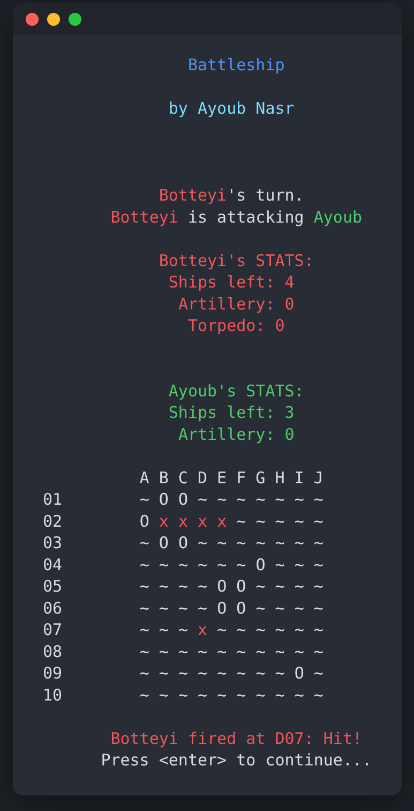
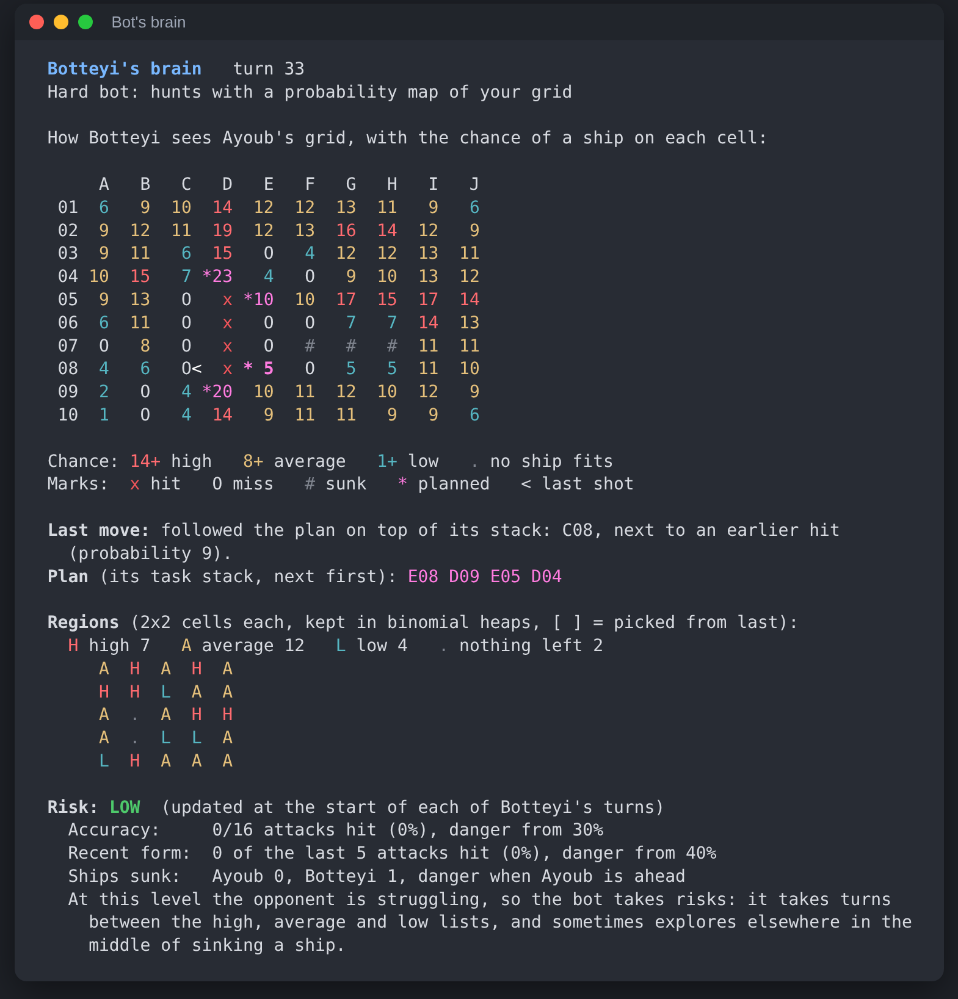

# Battleship

[](https://github.com/ayoubnasr/BattleShip/actions/workflows/ci.yml)

A terminal Battleship game written in C. You can play against a friend or against a bot. The hard bot hunts for your ships with a live
probability map of your grid, and adjusts how much risk it takes depending on how well you are playing.

Built for **CMPS 270 (Software Construction) at the American University of Beirut, Fall 2024**.

<p align="center"></p>

## Features

- **Two modes:** PvP (two players, one keyboard) and PvE (you against the bot).
- **Two bots:** an easy bot that fires at random, and a hard bot that uses probabilities.
- **Special weapons:** radar sweeps, smoke screens, artillery and torpedoes, each with its own unlock rule.
- **Two difficulties:** on hard, your misses are not marked on the grid.
- **Scalable:** the grid size is one macro, and the coordinate system grows with it (`A`…`Z`, then `AA`, `AB`…).

## Getting started

You need a C compiler and `make`:

| Platform | What to install |
| --- | --- |
| Linux | `gcc` and `make` (eg. `sudo apt install build-essential`) |
| macOS | Xcode command line tools (`xcode-select --install`) |
| Windows | [MinGW-w64](https://www.mingw-w64.org/) (gcc + `mingw32-make`), or WSL |

```sh
git clone https://github.com/ayoubnasr/BattleShip.git
cd BattleShip
make            # builds bin/battleship (bin/battleship.exe on Windows)
make run        # builds and starts the game
```

On Windows with MinGW, build with `mingw32-make` and start the game with `bin\battleship.exe`. Run it in a terminal that understands ANSI
colors (Windows Terminal, or any recent console).

**No compiler?** Every CI run builds a Windows executable: open the latest successful run on the
[Actions tab](https://github.com/ayoubnasr/BattleShip/actions/workflows/ci.yml) and download the `battleship-windows` artifact.

## How to play

1. Type `start`, choose the difficulty (`easy` or `hard`) and the mode (`PVP` or `PVE`).
2. Enter your name and place your four ships: give the first cell (eg. `B3`) and the orientation (`H` or `V`).
3. In PvE, pick the bot's difficulty (`easy` or `hard`). A random player goes first.

| Ship | Length |
| --- | --- |
| Carrier | 5 |
| Battleship | 4 |
| Destroyer | 3 |
| Submarine | 2 |

Coordinates are a column letter and a row number: `A1` is the top-left cell and `J10` the bottom-right (on the default 10x10 grid).
Lowercase works too.

### Commands

| Command | What it does | When you can use it |
| --- | --- | --- |
| `fire B4` | Fires at one cell. | Always. |
| `radar B4` | Tells you if any enemy ship is in the 2x2 area starting at `B4`. | 3 times per game. |
| `smoke B4` | Hides the 2x2 area starting at `B4` on your grid from enemy radar. | Once for each ship you have sunk. |
| `artillery B4` | Fires at the whole 2x2 area starting at `B4`. | Only on the turn right after you sink a ship. |
| `torpedo C` / `torpedo 7` | Fires at a whole column (letter) or row (number). | Only on the turn right after you sink a ship, once you have sunk 3. |
| `next` | Skips your turn. | Always. |
| `quit` | Exits the game. | At any prompt that asks you for something. |

On the grid, `~` is water, `x` is a hit and `O` is a miss (misses are only shown on **easy**). The first player to sink all four of the
opponent's ships wins.

## The bot

The hard bot is the heart of the project. The full design is in the
[presentation](docs/presentation.pdf) and the [bot design document](docs/bot-design.docx), and the long comment at the top of
[`src/Bot.c`](src/Bot.c) walks through the thinking behind it. In short:

1. **Probability grid** ([`CalcProbs.c`](src/CalcProbs.c)). Every cell of your grid gets a score: the number of ways the remaining ships
   could lie across it while fitting in the empty space, with no miss and no sunk ship in the way. Hits nearby raise the score, since
   the rest of a damaged ship must be close. When a ship sinks, the whole grid is recalculated without it.
2. **Probability regions** ([`Player.c`](src/Player.c), [`Bot.c`](src/Bot.c)). Always shooting the highest-scoring cell would make the bot
   predictable. So the grid is split into small regions, and each region keeps its cells in a **binomial heap**, ordered by probability.
   The regions are sorted into **high, average and low** probability lists. The bot picks a random region from a list, then takes that
   region's best cell. A hash set from region to heap and list node means that updating a region after a shot and moving it to another
   list both take constant time.
3. **Risk** ([`Bot.c`](src/Bot.c), `[Risk]` section). The bot watches your accuracy, your success rate over the last few turns, and how
   many ships each side has sunk. Normally it takes turns picking from the high, average and low lists. When you are doing badly, it
   takes more risks and sometimes explores elsewhere in the middle of sinking a ship. When you are doing well, it sticks to the highest
   probability regions, and when you are doing very well it fires at the single hottest cell.
4. **The brain** ([`Bot.c`](src/Bot.c)). A stack of tasks (a function pointer plus its arguments) that carries plans across turns: after a
   hit, the cells around it go on top of the stack and get fired at on the next turns until the ship sinks.
5. **Weapons and placement.** The hard bot uses its artillery and torpedo whenever the rules allow, aimed at the area with the highest
   total probability. It places at least one of its own ships where it is least likely to be found.

The easy bot fires at random, but it never fires at the same cell twice and it skips cells where no remaining ship could fit.

### Teaching the probabilities to read empty space

The first version of the probability grid had a weakness that showed late in a game. After the bot had fired at most of the board and
sunk a few ships, **every region fell into the low list**, so the high/average/low rotation stopped meaning anything. It had two causes:

1. **The scores couldn't see empty space.** A cell's score was the number of ways each ship could cross it while staying inside the grid
   edges, minus 1 for every miss nearby. Misses and sunk ships were only a rough patch on top. A cell in a 2-cell gap between two misses
   still scored about 7, when only the 2-long submarine fits there, in exactly 1 way.
2. **The list thresholds were fixed for the full fleet.** High meant 18+ and average 10+, out of a maximum of 2 × (5 + 4 + 3 + 2) = 28.
   But once only the destroyer and the submarine are left, no cell can score more than 2 × (3 + 2) = 10, so nothing could ever be high
   again.

The fixes, both in the spirit of the original design:

1. **Count the placements that really fit** ([`CalcCutoffProb()`](src/CalcProbs.c)). For each ship still afloat, count the ways it could
   cross the cell with no miss and no sunk ship in the way. The bonus for nearby hits stays, and the −1 per miss goes, since blocked
   placements are no longer counted. On an empty grid this gives exactly the same numbers as before (the presentation's formula
   `Min(x + 1, GRIDWIDTH - x, SHIPLENGTH)`), so only the late game changes.
2. **Scale the thresholds with the fleet** ([`UpdateProbabilityThresholds()`](src/Player.c)). Keep the original ratios (18/28 and 10/28)
   against the highest score still possible. They stay 18 and 10 with the full fleet, become 6 and 4 with only the destroyer and the
   submarine left, and update whenever a ship sinks.

**Results.** The hard bot played 2,000 games against randomly placed fleets with each version, counting the turns it needs to sink
everything:

| | Before | After | Change |
| --- | --- | --- | --- |
| Average turns to win, normal risk | 43.6 | **41.9** | 1.7 fewer turns (−4%) |
| Average turns to win, extremely high risk | 38.7 | **37.4** | 1.3 fewer turns (−3%) |
| Worst game, normal risk | 74 | **69** | |
| Worst game, extremely high risk | 84 | **62** | 22 fewer turns |

The averages are measured to within about ±0.25 turns (standard error), so the improvement is real, not luck. It is moderate because
most of the bot's choices are deliberately randomised to keep it unpredictable. The biggest gain is in its worst games: it no longer
wastes shots on space where no ship fits. At extremely high risk the bot always takes the single hottest cell, so that row shows the
difference in the probability numbers alone.

Run `make benchmark` to reproduce these numbers ([`tools/benchmark.c`](tools/benchmark.c)). The random generator is seeded with a fixed
value, so every run on the same code gives the same result. The "before" column is the same benchmark run on the previous version of
the code.

### Watch the bot think

When a PvE game starts, answer `yes` to **"Show the bot's thinking in a second window?"** and a second window shows the bot's mind,
updated after every turn:

- **Its map of your grid:** the probability of a ship on every cell, coloured by category, with its hits, misses and the ships it sank.
  It only shows what the bot knows, never where your ships are.
- **Its last move, explained:** which branch of its logic it took (a weapon, a plan from its stack, its turn in the high/average/low
  rotation, the hottest cell...) and why.
- **Its plans:** the cells waiting on its task stack, in the order it will try them (marked `*` on the map).
- **Its regions:** which list (high, average or low) every region is in, and the region it last picked from.
- **Its risk:** your accuracy, your recent form and the ships sunk on each side, compared with the thresholds that change its behaviour.

On Windows the window opens by itself. On Linux and macOS, open a second terminal in the same folder and run the command the game prints:
`./bin/battleship --bot-view battleship-bot-view.txt`.

<p align="center"></p>

The game writes a snapshot of the bot's state to `battleship-bot-view.txt` after every turn, and the viewer (the same program started with
`--bot-view`) redraws it whenever it changes. The code is in [`src/BotView.c`](src/BotView.c).

### Tuning

Most of the game and the bot's intelligence can be changed with macros:

| Macro | File | Effect |
| --- | --- | --- |
| `GRIDSIZE` | [`include/defs.h`](include/defs.h) | Size of the (square) grid. |
| `PROB_REGION_WIDTH` / `PROB_REGION_HEIGHT` | [`include/Player.h`](include/Player.h) | Region size: the "resolution" of the bot's statistics. Smaller regions mean a sharper bot. |
| `HIGHPROB_BASE` / `AVGPROB_BASE` / `LOWPROB_BASE` | [`include/Player.h`](include/Player.h) | Probability needed for a region to be in the high, average or low list with the full fleet. As ships sink, the high and average thresholds scale down with the highest score still possible. |
| `RISK_*`, `LOWRISK_EXPLORE_CHANCE` | [`include/Player.h`](include/Player.h) | How quickly the bot feels threatened, and how adventurous it gets at low risk. |

## Tests

```sh
make test
```

This runs the unit tests in [`tests/`](tests). They need nothing but the compiler and cover:
- coordinates and input parsing
- the linked list and the binomial heap
- ship placement and every attack
- the probability grid and the region system (its consistency is checked after every shot)
- both bots playing complete games
- the bot's view: its decisions, and its snapshots written and read back

CI runs them on Linux and macOS on every push. `make benchmark` measures how many turns the hard bot needs to win (see
[above](#teaching-the-probabilities-to-read-empty-space)).

## Project structure

```
.
├── src/                 game source
│   ├── Driver.c         main(), menus, turns and everything printed on screen
│   ├── Player.c         player setup, grid display, probability regions
│   ├── Bot.c            the bots: targeting, task stack, weapons, risk, ship placement
│   ├── BotView.c        the "watch the bot think" window: snapshots and their display
│   ├── CalcProbs.c      probability formulas
│   ├── Attacks.c        fire, radar, smoke screen, artillery, torpedo
│   ├── ShipPlacement.c  placing ships on a grid
│   ├── BinomialHeap.c   generic binomial heap
│   ├── D_LinkedList.c   generic doubly linked list
│   ├── coordslib.c      coordinate system (eg. "B4" -> row 3, column 1)
│   ├── InputLib.c       safe input reading and parsing
│   ├── UITools.c        colors, centered printing, console size
│   ├── ShortcutFuncs.c  small string helpers
│   └── defs.c
├── include/             headers (constants and settings are in defs.h and Player.h)
├── tests/               unit tests (make test)
├── tools/               benchmark of the hard bot (make benchmark)
├── docs/                presentation, design documents, backlog and test plan
└── Makefile
```

## Author

Ayoub Nasr
